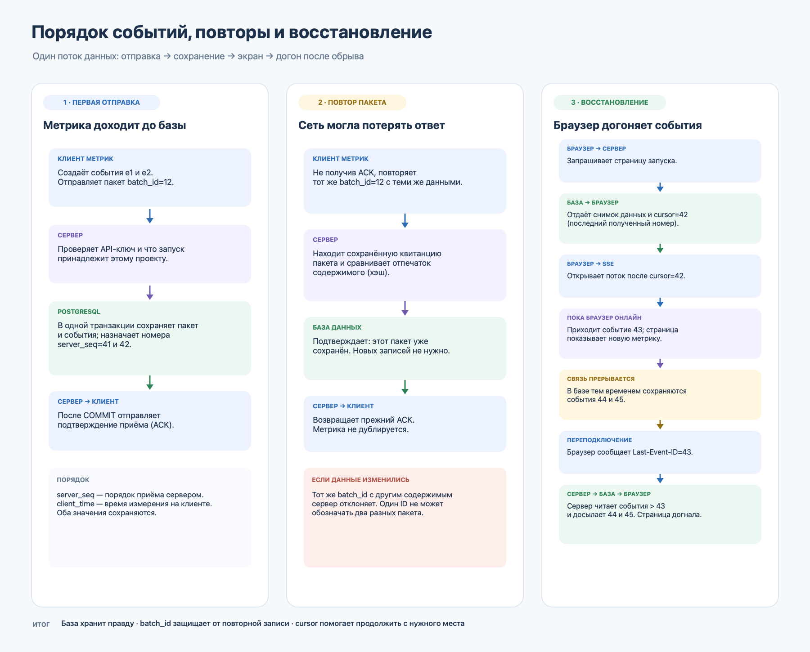

# Soup — мини-трекер экспериментов

Веб-приложение принимает метрики от программы эксперимента, сохраняет их в PostgreSQL и показывает на странице запуска с обновлениями в реальном времени.

## Запуск

Нужен Docker с поддержкой Docker Compose.

```bash
docker compose up --build
```

Откройте [http://localhost:8000](http://localhost:8000). Создайте проект, затем создайте запуск. В Swagger UI доступны все HTTP-эндпоинты: [http://localhost:8000/docs](http://localhost:8000/docs).

## Как отправить метрику

Скопируйте API-ключ в боковой панели и отправьте пакет:

```bash
curl -X POST http://localhost:8000/api/runs/RUN_ID/metrics \
  -H 'Content-Type: application/json' \
  -H 'X-API-Key: YOUR_API_KEY' \
  -d '{
    "batch_id": "a0eebc99-9c0b-4ef8-bb6d-6bb9bd380a11",
    "events": [{
      "event_id": "a0eebc99-9c0b-4ef8-bb6d-6bb9bd380a12",
      "metric_name": "accuracy",
      "value": 0.91,
      "client_time": "2026-11-10T10:00:00Z"
    }]
  }'
```

При сетевом повторе используйте те же `batch_id` и содержимое. Новый пакет получает новый `batch_id`; каждое новое событие — новый `event_id`.

## Архитектурные решения

- PostgreSQL — единственный источник истины. Нет отдельного кэша или очереди событий.
- Для каждого запуска сервер блокирует строку запуска внутри транзакции и назначает новые возрастающие `server_seq` в порядке фиксации. `client_time` хранится отдельно и не меняет порядок потока.
- Таблица квитанций уникальна по `(run_id, batch_id)`. Тот же пакет с тем же хэшем возвращает прежний результат; тот же ID с другим содержимым получает `409`.
- `event_id` уникален в пределах запуска. Повторное событие не создаётся заново; повтор с изменённым содержимым отклоняется.
- События и квитанция пакета записываются одной транзакцией. SSE-поток раз в 0,5 секунды читает журнал PostgreSQL; отдельной очереди и непрочной in-memory очереди нет.
- `GET /api/runs/{id}` возвращает снимок и его курсор в одном `REPEATABLE READ` снимке. SSE выдаёт сохранённые события с `server_seq > cursor`; при переподключении браузер запрашивает тот же диапазон заново.
- API-ключ хранится в базе только в виде SHA-256 хэша и относится к одному проекту. Все операции с запуском, включая чтение и SSE, сверяют владельца проекта. Чужой или отсутствующий запуск отвечает одинаковым `404`.
- Страница использует ключ в `localStorage` для локального демо. Не используйте такой способ хранения ключей как готовую модель аутентификации для публичного продукта.

Полное описание потока: [docs/design.md](docs/design.md). Схема порядка, повторов и восстановления:



Краткая записка для сдачи задания: [docs/submission-note.md](docs/submission-note.md).

## Проверки

Поднимите PostgreSQL через Compose и запустите интеграционные тесты:

```bash
docker compose --profile test run --rm tests
```

Шесть интеграционных тестов проверяют повторы пакетов и событий, последовательность при параллельных запросах, снимок и восстановление SSE по курсору, изоляцию проектов и отзыв старого API-ключа. Вывод: [test-results.txt](outputs/test-results.txt).

Браузерный сценарий открывает проект, отправляет метрику через интерфейс, отключает браузер от сети, отправляет события через API и сверяет курсор страницы со снимком сервера после восстановления. Установка и запуск: `pip install -r requirements-e2e.txt`, `python -m playwright install chromium`, `python scripts/browser_e2e.py`. Вывод: [browser-e2e-output.txt](outputs/browser-e2e-output.txt).

Нагрузочный сценарий создаёт 50 запусков и посылает 10 событий в секунду на каждый:

```bash
mkdir -p work
docker compose exec app python scripts/load_check.py --seconds 10 > outputs/load-results.txt
```

Один 10-секундный прогон прошёл: 50 запусков, 50 одновременных SSE-подключений, 10 событий/с на запуск, 5 000 событий доставлены и сверены со снимками базы. Ошибок и расхождений не было; p95 HTTP-запроса — 57,9 мс, максимум — 84,4 мс. [Сырой вывод](outputs/load-results.txt).

**Вердикт: ВЫПУСКАТЬ** для заданной нагрузки по этому прогону. Перед увеличением нагрузки сначала провести более длительный прогон и добавить наблюдение за задержкой, отставанием SSE и ожиданием соединений с базой.
